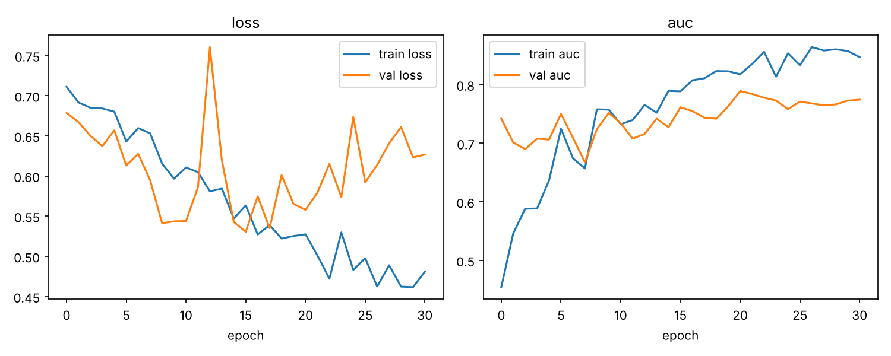
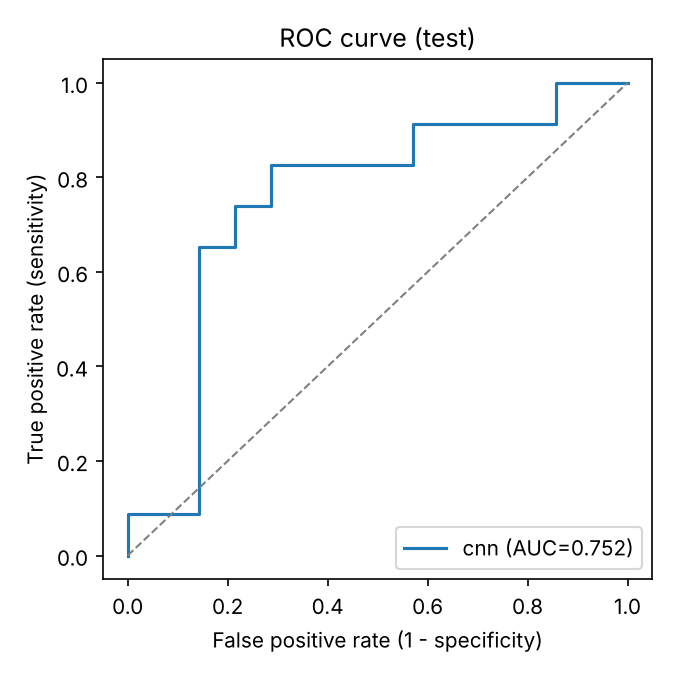
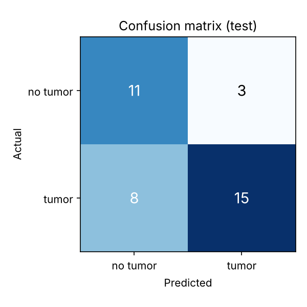

# Brain Tumour Detection from MRI (CNN)

Binary classification of axial brain MRI slices (**tumour / no tumour**). The project is built
as a reproducible data-science pipeline: data validation, leakage-safe splits, cross-validated
model selection, a held-out test set and a Flask app. All stages share one preprocessing function.

> ⚠️ This is a research and education project on a small public dataset (253 images).
> It is **not** a medical device and must not be used for diagnosis.

---

## Results

**5-fold grouped cross-validation** on the development set (train+val, 216 images, mean ± std):

| Model | ROC-AUC | Balanced acc. | Sensitivity | Specificity | F1 |
|---|---|---|---|---|---|
| Logistic regression (32×32 pixels), baseline | 0.696 ± 0.067 | 0.640 ± 0.076 | 0.576 ± 0.146 | 0.704 ± 0.096 | 0.642 ± 0.116 |
| **CNN (deployed)** | **0.768 ± 0.052** | **0.704 ± 0.041** | **0.695 ± 0.124** | **0.713 ± 0.074** | **0.735 ± 0.075** |
| BiLSTM (row-as-timestep) | 0.539 ± 0.067 | 0.499 ± 0.049 | 0.527 ± 0.228 | 0.471 ± 0.320 | 0.539 ± 0.127 |

**Held-out test set** (37 images, never used for training, tuning or threshold choice). Threshold = 0.63, picked on validation:

| Metric | Value | 95% bootstrap CI |
|---|---|---|
| ROC-AUC | **0.75** | 0.55 – 0.92 |
| Accuracy | 0.70 | 0.54 – 0.84 |
| Sensitivity (tumours caught) | 0.65 (15/23) | 0.46 – 0.84 |
| Specificity | 0.79 (11/14) | 0.54 – 1.00 |
| Precision | 0.83 | |

Confusion matrix (test): TN 11 · FP 3 · FN 8 · TP 15.

<p>



</p>

**How to read this.** These numbers are lower than the 91.7% in the original notebook, and that
is expected. The original figure was measured mostly on training images, with a single-class
validation set. The figures here are an honest estimate. The test set and the CV agree (AUC ≈ 0.75–0.77).
With 37 test images the intervals are wide, and 8 missed tumours out of 23 is far too many for any
screening use. More data and transfer learning are the levers (see *Limitations*).

---

## Pipeline architecture

```mermaid
flowchart LR
    subgraph D["Data layer"]
        A["1. Ingest<br/>data/raw/{yes,no}<br/>explicit label map"] --> B["2. Validate<br/>unreadable files · class balance<br/>exact + near duplicates"]
        B --> C["3. Split<br/>stratified + duplicate-grouped<br/>train / val / test + 5 CV folds<br/>→ manifest.csv"]
    end
    subgraph M["Modelling layer"]
        P["4. Preprocess (shared)<br/>gray → crop brain → 128² → /255"]
        E["5. Model selection<br/>5-fold grouped CV<br/>logreg · CNN · LSTM"]
        T["6. Train final model<br/>augmentation · class weights<br/>early stopping on val"]
        H["Threshold tuned on val<br/>(Youden's J)"]
        V["7. Evaluate ONCE on test<br/>AUC · sensitivity · specificity<br/>bootstrap 95% CI"]
    end
    subgraph S["Serving layer"]
        R["Model registry<br/>models/*.keras + metadata.json<br/>(label map, threshold, preprocessing)"]
        F["8. Flask app<br/>/predict · /health"]
    end
    C --> P --> E --> T --> H --> V --> R --> F
    P -. same function .-> F
```



| # | Stage | What it does | Where |
|---|---|---|---|
| 1 | **Ingest** | Lists images and assigns labels from an explicit `{"no": 0, "yes": 1}` map in the config, never from folder order | `src/brain_tumor/data.py` |
| 2 | **Validate** | Checks for unreadable files and class imbalance, finds byte-identical files (MD5) and near-duplicates (thumbnail correlation ≥ 0.97), and flags duplicates with conflicting labels → `reports/data_quality.json` | `data.py` |
| 3 | **Split** | `StratifiedGroupKFold`: 70/15/15 train/val/test plus 5 CV folds on train+val. Duplicate groups never cross splits. Saved to `data/processed/manifest.csv` so every run uses the same split | `data.py` |
| 4 | **Preprocess** | Grayscale → crop to brain contour → 128×128 → /255. **One function** used by training, the notebook and the app | `preprocess.py` |
| 5 | **Model selection** | 5-fold grouped CV comparing a logistic-regression baseline, the CNN and a BiLSTM. The test set is never touched | `experiments.py` |
| 6 | **Train** | Final CNN on train. Uses in-model augmentation, class weights, early stopping and LR decay on the val set | `train.py`, `models.py` |
| 7 | **Evaluate** | Picks the threshold on val, then reports the test set once: ROC-AUC, sensitivity, specificity, precision, F1, confusion matrix and bootstrap 95% CIs | `evaluate.py` |
| 8 | **Serve** | Flask loads the model **and its metadata**, so the label map, threshold and preprocessing match training. Uploads are processed in memory | `app.py` |

Everything is configured in [`configs/config.yaml`](configs/config.yaml).

---

## Quick start

```bash
pip install -r requirements.txt
# 1. put the Kaggle dataset in data/raw/brain_tumor_dataset/{yes,no}  (see data/README.md)
export PYTHONPATH=src
python -m brain_tumor.data                      # validate + split → manifest.csv
python -m brain_tumor.experiments               # 5-fold CV: logreg vs CNN vs LSTM
python -m brain_tumor.train --model cnn         # final model + test report
pytest -q                                       # sanity tests
python app.py                                   # http://127.0.0.1:5000
```

Optional: `python -m brain_tumor.train --model transfer` fine-tunes an ImageNet MobileNetV2.
It downloads pretrained weights, so run it where you have internet (for example Colab). It is the
most promising next step for a dataset this small.

## Project structure

```
├── configs/config.yaml          # all paths + hyper-parameters
├── data/
│   ├── README.md                # source, setup, known data issues
│   └── processed/manifest.csv   # fixed split (raw images are git-ignored)
├── src/brain_tumor/
│   ├── data.py                  # ingest · validate · split
│   ├── preprocess.py            # shared preprocessing
│   ├── models.py                # cnn · lstm · transfer
│   ├── experiments.py           # cross-validated model comparison
│   ├── train.py                 # final training + artifact
│   └── evaluate.py              # metrics, threshold, CIs, plots
├── models/                      # brain_tumor_cnn.keras + .json metadata
├── reports/                     # data_quality.json, cv_results.*, figures/
├── notebooks/
│   ├── 01_brain_tumor_pipeline.ipynb   # walkthrough with EDA + error analysis
│   └── 00_original_experiment.ipynb    # original work, kept for history (superseded)
├── tests/test_pipeline.py
├── app.py · templates/ · static/
```

---

## What was fixed (review of the original version)

| # | Issue in original | Impact | Fix |
|---|---|---|---|
| 1 | Labels came from `os.listdir()` order (`['yes','no']`), so **tumour = 0**. The app said "has tumour" when output > 0.5 | **Every app prediction was inverted.** Checked against the original `brain_tumor.h5`: 0% of tumour scans were flagged as tumour, and 79% of healthy scans were | Explicit label map in config. The positive class (tumour) = 1 |
| 2 | The app resized uploads to **224×224 RGB**. The model expects **128×128 grayscale** | The app crashed on every prediction | One shared `preprocess` module. The app reads its settings from model metadata |
| 3 | `validation_split=0.2` on unshuffled arrays | The validation set was **100% "no tumour"** images | Explicit stratified train/val/test split |
| 4 | The 91.7% "accuracy" came from `model.evaluate` on the **whole dataset** (80% of it training data) | The reported accuracy was not a real performance estimate | Held-out test set used once, plus 5-fold CV and 95% CIs |
| 5 | The classification report (95%) used 20 random **training** images (`randint` repeats indices and never picks the last image) | Same as above | Full test-set report |
| 6 | 25 byte-identical duplicates plus re-saved copies (73 images in duplicate groups) | Train→test leakage that inflates scores | Duplicate-grouped splitting |
| 7 | Severe overfitting (train 100%, val 64.7%, val loss rising to 2.86) with no regularisation | The model memorised the training set | Augmentation, dropout, class weights, early stopping |
| 8 | Min-max normalisation used whole-dataset statistics. The app used `/255` | Train/serve skew and test leakage | Fixed `/255` per image in both places |
| 9 | `CNNOptimization.ipynb` tuned a model on **Fashion-MNIST** | Unrelated to this project | Removed. Model selection is now done on the MRI data (`experiments.py`) |
| 10 | `docs/m06-data/lab06.ipynb` was a data-viz course assignment (Pew religion/income) | Unrelated | Removed |
| 11 | `brain_tumor.pkl` (Keras model pickled with joblib) and `tensorflow_hub` import | Duplicate, fragile artifact. Hub layer unused | Single `.keras` artifact + JSON metadata |
| 12 | Templates folder named `template/` (Flask expects `templates/`). Page title said "Cell_Image Classifier". Dead `cdn.bootcss.com` links. `/predict` GET returned `None` | The app didn't render | Fixed. Added `/health`, file-type checks and error messages |
| 13 | The screenshot in `img/` showed a different (TF-Hub) model's output | Misleading | Removed |
| 14 | Empty README, no requirements, no tests | Not reproducible | Added |

### On CNN vs LSTM / RNN

An LSTM or RNN models **sequences**. A single MRI slice is a 2D image whose signal is spatial,
which is what convolutions capture. To test this rather than assume it, the pipeline includes a
BiLSTM baseline that reads the image row by row. In cross-validation it performs at roughly
chance level (table above). Sequence models make sense for this problem if you have **3D
volumes** (a stack of slices per patient, e.g. BraTS) or **longitudinal scans** (CNN encoder +
LSTM over time). Neither applies to this dataset, so the deployed model is the CNN.

### Model design decisions

- A deeper CNN with BatchNorm + global average pooling was tried first. On ~135 training images
  per fold it collapsed to a constant output (≈0.65 for every image) and early-stopped by epoch 2.
  With ~9 steps per epoch, BatchNorm's moving statistics never settle. A lighter 3-block CNN with
  a dropout-regularised dense head learned reliably. That comparison is why `build_cnn` looks the
  way it does.
- The threshold is chosen on validation with **Youden's J**. F2, an early candidate, collapses
  specificity here: with 61% positives, predicting "tumour" for everything already scores
  F2 ≈ 0.89. For a screening deployment, set `threshold_metric: "min_sensitivity:0.95"`.

## Limitations

- Small dataset (253 slices, single public source). Test-set CIs are wide.
- No patient IDs, so different slices of one patient could be split across train and test.
- No external validation, no calibration study, no Grad-CAM yet. All are recommended next steps.

## Data

Kaggle: *Brain MRI Images for Brain Tumor Detection* (Navoneel Chakrabarty). See [`data/README.md`](data/README.md).
